<a href="https://pranavkadam.in">
  
</a>

<p align="center">
  <a href="https://pranavkadam.in"><b>pranavkadam.in</b></a>
  &nbsp;·&nbsp;
  <a href="https://pranavkadam.in/projects">Projects</a>
  &nbsp;·&nbsp;
  <a href="https://pranavkadam.in/about-pranav">README</a>
  &nbsp;·&nbsp;
  <a href="https://pranavkadam.in/resume">Resume</a>
  &nbsp;·&nbsp;
  <a href="https://pranavkadam.in/lets-fun">Playground</a>
  &nbsp;·&nbsp;
  <a href="https://pranavkadam.in/contact">Contact</a>
</p>


## Hi, I'm Pranav

Final-year **B.Tech in Artificial Intelligence & Machine Learning** at **Sandip University, Nashik**.
I've been writing software independently since 2023 — Windows desktop apps, web platforms and automation tools —
and I'm turning that work into a **multi-product software company**.




## The product line

| | Product | Platform | What it does |
|:-:|---|---|---|
| 🟦 | **Propel** | Windows | A PC care app for Windows machines |
| 🟩 | **[CodeVault](https://codevaultofficial.in/)** | Web | Marketplace for source code, UI kits, animations and full-stack templates |
| 🟨 | **[DeepScan AI](https://deepscan-ai.vercel.app/)** | AI | Deepfake and authenticity detection across images, video, audio and text |
| 🟧 | **WatchDog** | Android | A privacy auditor for Android devices |
| 🟥 | **Resume Screening System** | AI | Screens resumes and helps identify the stronger candidates for a role |

### Also live

| Project | What it is | Link |
|---|---|---|
| **CleanMaster Pro** | Windows optimization software — Python + PyInstaller, real-time scanning, licensing, auto-updates | [cleanmasterpro.in](https://cleanmasterpro.in) |
| **IncomeOS** | AI financial planning and income strategy platform | [income-os-weld.vercel.app](https://income-os-weld.vercel.app/) |
| **BulletProof Panel** | Security and server management control panel | [railway.app](https://bulletproof-panel-production.up.railway.app/) |
| **ResumeIQ** | AI resume screening and optimization | *coming soon* |


## Inside this site

A dark **"Developer OS"** interface — graphite canvas, blue → cyan accent, Geist Sans + Geist Mono, bento grids and hairline borders.

| Route | What's there |
|---|---|
| `/` | Orbit hero, product bento, live projects, toolkit |
| `/about` · `/about-pranav` | Profile bento · a README-style long read with a scroll-tracked contents |
| `/projects` | Filterable project grid with tilt cards |
| `/skills` | Grouped toolkit |
| `/github` | Live repositories from the GitHub API, refreshed hourly |
| `/resume` | Document viewer with an at-a-glance panel |
| `/lets-fun` | A working terminal — `help`, `projects`, `open deepscan-ai`, Tab completion, history |
| `/brain-mode` | Predict-the-output JavaScript quiz |
| **Nova** | AI assistant in the corner of every page (Groq) |

**Motion**

- **Particles** — WebGL particle field behind the whole site
- **Dot Grid** — spring-physics dot grids behind the hero, bento and page headers
- **Orbit Images** — the toolkit icons orbiting a live `whoami` card in the hero
- **Shiny Text** — light sweeps across the name and section titles
- **Framer Motion** — cursor-tracking tilt + spotlight cards, scroll reveals, layout-animated filters


## Run it locally

```bash
npm install
npm run dev
```

Nova needs a Groq key in `.env.local`:

```bash
GROQ_API_KEY=your_key_here
```

```
app/                     routes, globals.css (reset · tokens · fonts), /api/nova
components/<domain>/     each component next to its own .module.css
components/animations/   Particles · DotGrid · OrbitImages · ShinyText
data/                    profile, products, projects, skills, navigation
```

<br />


<p align="center">
  <a href="https://github.com/prnv-dev">GitHub</a>
  &nbsp;·&nbsp;
  <a href="https://www.linkedin.com/in/pranav-kadam-2ab2893a7">LinkedIn</a>
  &nbsp;·&nbsp;
  <a href="https://t.me/DEVID_xx">Telegram</a>
  &nbsp;·&nbsp;
  <a href="https://www.instagram.com/mr.pranav_0x">Instagram</a>
  &nbsp;·&nbsp;
  <a href="mailto:iampranavkadam@gmail.com">Email</a>
  <br />
  <sub>Developed by Pranav · MIT License</sub>
</p>
